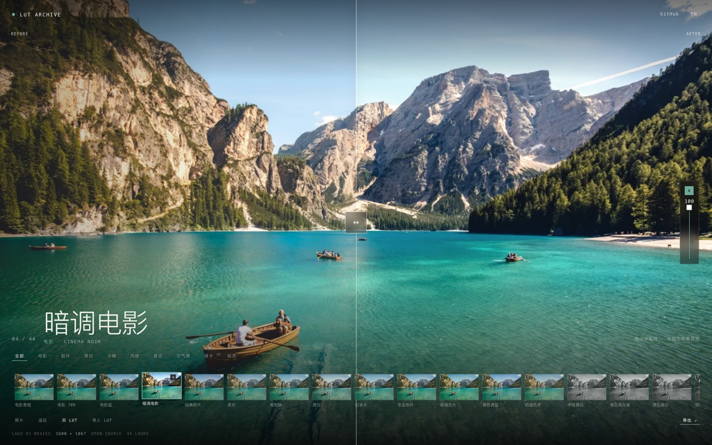

# LUT Archive

A darkroom-style photo editor that runs entirely in your browser: open a RAW,
develop it with a Lightroom-style panel (white balance, tone, presence,
histogram, before/after), then stack one of 44 generated looks on top. Full-bleed
image, split-view compare, dual-LUT stacking, `.cube` import and full-resolution
JPEG export — no accounts, no uploads, no server-side rendering.

**Live demo:** <https://lut.openanthropic.com>

| Desktop | Mobile |
| --- | --- |
|  |  |

Dual-LUT stacking:


Develop panel — a RAW opens neutral, no LUT in the way:


## Features

- **44 original LUT looks** — cinema, film, B&W, Leica, Hasselblad and more,
  all generated from the recipes in `scripts/looks.mjs` and bundled as a single
  ~850 KB binary. The same looks ship as standard `.cube` files in `luts-src/`
  for use in Resolve, Premiere, Photoshop, etc.
- **Split compare** — drag the vertical line; long-press the right side to see
  the original, release to restore. Fit/fill state is never touched.
- **Dual LUT stacking** — apply two looks at once with independent strength
  rails. Useful for a base grade plus a subtle skin-tone or highlight tweak.
- **Fit / fill**, drag-and-drop upload, EXIF orientation handled, full-resolution
  rendering.
- **Export** — JPEG at 50 / 75 / 100% of the source long edge, full resolution
  even past the GPU texture limit (rendered in tiles and stitched), quality
  0.90 / 0.95 / 0.98.
- **Categories and named thumbnails** — filter the strip by 电影 / 胶片 / 黑白 /
  冷暖 / 风格 / 复古 / 空气感 / 徕卡 / 哈苏, every thumbnail carries its look name.
- **Import your own LUTs** — drop any `.cube` into the app: 3D LUTs
  (`LUT_3D_SIZE` 2–128) and 1D LUTs both work, UTF-8 BOMs are tolerated, and a 1D
  curve is baked onto a 3D grid so the renderer only deals with one texture type.
  Files are parsed locally, stored in IndexedDB and appear under “我的 LUT / My
  LUTs”. Nothing is uploaded, and a file that cannot be parsed says why.
- **Input profile switch** — `sRGB / F-Log / F-Log2 / V-Log`. Vendor LUTs are built
  for log input; applying them to a normal photo blows out the sky and crushes the
  shadows. The app detects `F-Log`/`V-Log` from the imported LUT name, switches the
  profile automatically, and re-encodes the photo with the published transfer
  function before the LUT runs. Gamut is still treated as sRGB, so vendor LUTs are
  close but not byte-exact.
- **RAW uploads are really developed** — NEF/CR2/CR3/ARW/DNG/RAF… go through
  [flashraw](https://github.com/ybouane/flashraw) compiled to WebAssembly (vendored
  under `public/vendor/flashraw`, ~3.4 MB, fetched only when a RAW is actually
  opened). Unpacking, AHD demosaicing, camera white balance, the camera colour
  matrix and the sRGB encode all run in a Web Worker on your machine: a 26 MP Nikon
  Z50 II NEF becomes a full-resolution 5568×3712 frame in ~1 s, and 100% export is
  100% of that. This includes Nikon's **HE/HE\*** (TicoRAW) compression, which most
  open-source RAW tools still cannot read. If a file cannot be unpacked at all, the
  app falls back to the camera JPEG embedded in it. RAW files also get an
  automatic brightness correction (percentile based, brightness only — no colour,
  saturation or white balance), applied as a linear exposure so the preview and the
  export always match; the `AUTO` button in the toolbar turns it off.
- **Develop panel, Lightroom-style** — opening any photo lands in a Develop rail
  (a bottom sheet on phones) with the camera's own render and **no LUT applied**,
  so you are looking at your RAW, not at somebody's look. White balance
  (temp / tint plus an eyedropper that samples a neutral from the frame), the full
  Light panel (exposure, contrast, highlights, shadows, whites, blacks), and
  Presence (vibrance, saturation). Every slider is applied in the shader — no
  re-decode — and the preview, the filmstrip thumbnails and the export all go
  through the same `adjFor()`, so what you judge is what you get. A live RGB
  histogram sits above the sliders, `自动色调 / Auto tone` places the whole tone
  group from the histogram, and the split line keeps working as before/after
  against the untouched camera render. The 44 looks stay one click away on the
  filmstrip and stack on top of the develop settings.
- **Tone controls that behave like a darkroom tool** — the five tone sliders are
  one monotone curve sampled in log2 luminance, not gamma-space offsets:
  `shadows` / `highlights` are exposure corrections confined to their own band
  (lifting shadows cannot grey out the midtones), `whites` moves only the top of
  the range so it acts as a white point, and `blacks` moves a real additive black
  point (a gain can never lift a true black). The curve is applied as a luminance
  ratio in linear light, which keeps hue; `npm run test:tone` proves it is
  monotone for 3,125 setting combinations and checks the band separation.
- **Bilingual UI** — Chinese / English, switchable and remembered. First visit
  picks the language from the visitor's country (CN/TW/HK/MO → Chinese).
- **Nothing leaves the device** — decoding, grading and encoding all happen in
  the browser. The only network calls are for static assets and a country code.

## How it works

The editor is plain ES modules and WebGL2 — no framework, no build step for the
app itself.

- `public/js/renderer.js` — `LookRenderer`: uploads the LUT binary as a 3D
  texture (17³ RGBA, trilinear filtering) and grades the photo in a fragment
  shader. The pipeline is exposure and white balance in linear light (channel
  gains, so highlights do not clip channel-by-channel) → a tone curve sampled in
  log2 luminance from a 1024-entry R16F LUT (built on the CPU by
  `buildToneCurve()`, see the references below) → vibrance / saturation around
  luma → optional LOG encode → 1–3 stacked LUTs. Also handles `cover`/`contain`
  fit and UV flipping. One `adjFor()` object feeds the preview, the thumbnails
  and the export.
- **Tone model references** — the log-exposure domain with explicit black/white
  points, latitude and toe/shoulder follows [darktable's filmic
  RGB](https://github.com/darktable-org/darktable/blob/master/src/iop/filmicrgb.c);
  the per-zone masked exposure corrections follow [darktable's tone
  equalizer](https://github.com/darktable-org/darktable/blob/master/src/iop/toneequal.c);
  [RawTherapee's Shadows/Highlights](https://github.com/RawTherapee/RawTherapee/blob/dev/rtengine/ipshadowshighlights.cc)
  is the reference for keeping chroma stable when shadows are lifted. Both are
  GPL, so only the maths was studied — no source code is copied, and this
  implementation is an independent WebGL/JS one (MIT).
- `public/js/looks.js` — the manifest: id, display names, category, filmstrip
  ordering.
- `public/luts.bin` — 44 × 17³ RGBA blocks, in manifest order (~850 KB).
- `luts-src/*.cube` — the 33³ source cubes, generated by `npm run export:cubes`
  from `scripts/looks.mjs`. `npm run build:luts` resamples them into
  `public/luts.bin`.
- `src/worker.js` — a ~20 line Cloudflare Worker: serves the assets and
  `/api/geo`, which returns `request.cf.country` for language detection.

## Run locally

```bash
npm install
npm run dev        # wrangler dev → http://localhost:8787
npm run test:tone  # tone-curve invariants (identity, monotone, band separation)
```

Any static file server works too (`python3 -m http.server -d public`), except
that `/api/geo` will 404 and the UI falls back to `navigator.language`.

## Deploy

```bash
npm run deploy
```

`wrangler.jsonc` binds a custom domain (`lut.openanthropic.com`) via
`routes[].custom_domain` — wrangler creates the DNS record and certificate, so
the zone must live on the same Cloudflare account. Remove the `routes` block to
deploy to `*.workers.dev` instead.

## LUT files

`luts-src/` holds one 33³ `.cube` per look (44 files, named after the look id).
They are the source of truth for the site and are meant to be downloaded and used
in other software:

- **Download all** — grab the [44-look `.cube` pack](https://github.com/shisongsong/lut-studio/releases)
  (zip, ~11 MB) from Releases, or browse
  [`luts-src/`](https://github.com/shisongsong/lut-studio/tree/main/luts-src) and
  pick a single file.
- **Regenerate** — `npm run export:cubes` rewrites every `.cube` from the recipes
  in `scripts/looks.mjs`; output is deterministic (5-decimal values), so re-running
  it is a no-op for existing files.
- **Bake for the web** — `npm run build:luts` resamples each 33³ cube to 17³ and
  writes `public/luts.bin` (one RGBA block per look, in `public/js/looks.js` order).

Adding a look: add a recipe to `GRADES` in `scripts/looks.mjs`, add the matching
entry to `public/js/looks.js`, then run `npm run export:cubes && npm run build:luts`.
The build fails if the manifest and the recipes disagree.

### Why vendor LUTs are not bundled

Panasonic VariCam/LUMIX, FUJIFILM F-Log, Canon, Nikon and Sony LUTs are free to
download but their terms only allow local personal use — they cannot be
redistributed in a public repository. The **Import LUT** button is the legal
path: download the official `.cube` from the vendor, import it locally, and it
stays on your device (IndexedDB). See `/get-luts` for the official download pages
and import instructions.

## Project layout

```
public/            # the whole app (no build step)
  index.html       # UI + inline CSS + app logic
  js/renderer.js   # WebGL2 LUT renderer
  js/looks.js      # LUT manifest
  js/i18n.js       # zh/en strings
  js/lut-store.js  # IndexedDB store for imported .cube LUTs
  luts.bin         # baked LUT texture (44 looks)
  get-luts.html    # how to get vendor LUTs + download the bundled ones
  photos/demo.webp # default demo photo
  fonts/           # IBM Plex Mono, Instrument Sans/Serif (woff2)
luts-src/          # 44 × 33³ .cube files (downloadable)
scripts/           # build-luts.mjs
src/worker.js      # Cloudflare Worker (assets + /api/geo)
```

## Privacy

There is no backend state. No accounts, no database, no cookies. The language
preference is stored in `localStorage` (`lut.lang`); `/api/geo` returns a
two-letter country code derived from the Cloudflare edge and nothing is stored.
Imported LUTs are kept in IndexedDB on your device — they are never uploaded.

## Credits

- **Fonts** — IBM Plex Mono, Instrument Sans and Instrument Serif, distributed
  under the SIL Open Font License 1.1.
- **Sample photo** — original photograph by the author (Nikon Z50 II, Positano).
- **LUT looks, renderer, UI** — original work, MIT.

## License

[MIT](LICENSE)
