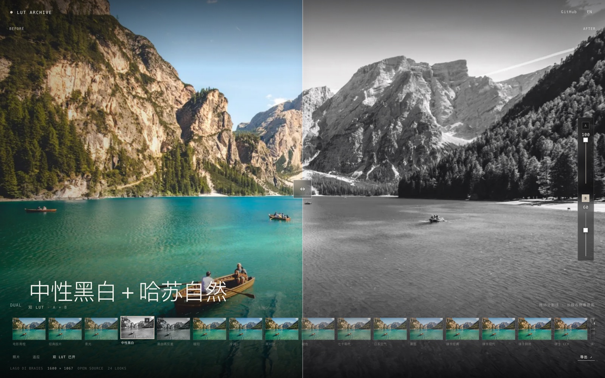
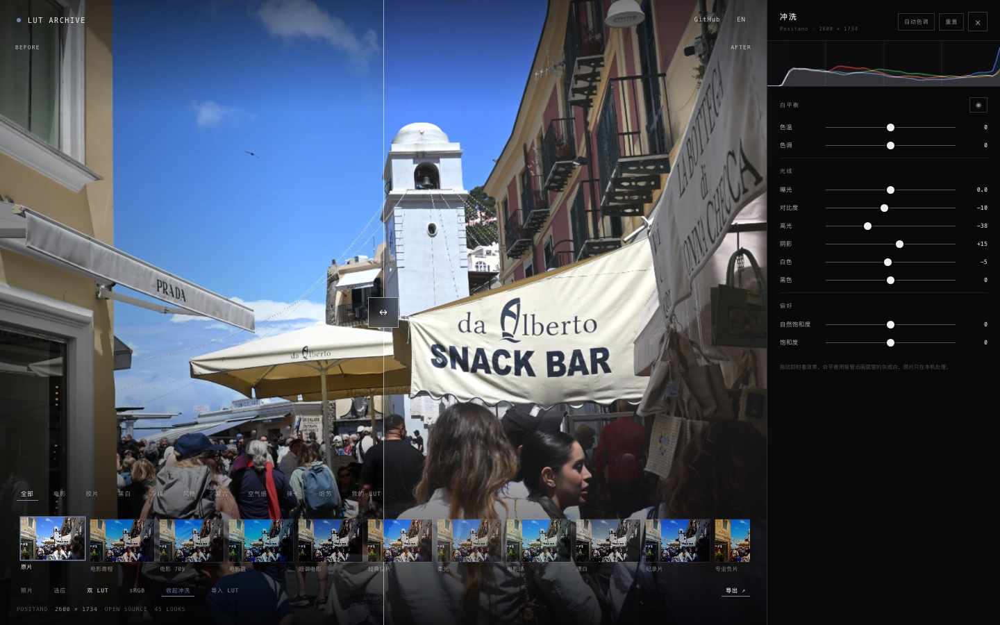
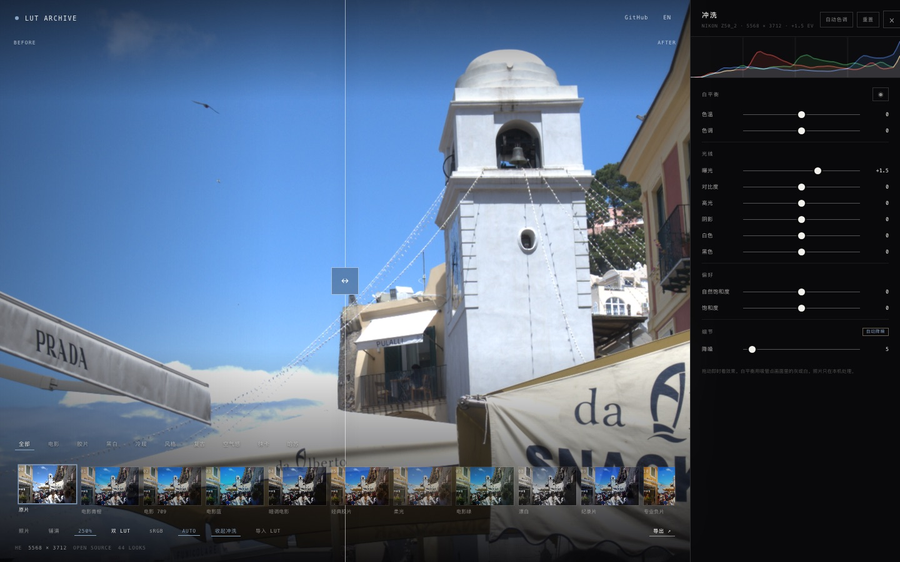

# LUT Archive

A darkroom-style photo editor that runs entirely in your browser: open a RAW,
develop it with a Lightroom-style panel (white balance, tone, presence,
histogram, before/after), then stack one of 44 generated looks on top. Fit-to-frame
preview with pinch/wheel zoom and drag-to-pan at full resolution, split-view
compare, dual-LUT stacking, `.cube` import and full-resolution JPEG export — no
accounts, no uploads, no server-side rendering.

**Live demo:** <https://lut.openanthropic.com>

| Desktop | Mobile |
| --- | --- |
|  |  |

Dual-LUT stacking:



Develop panel — a RAW opens neutral, no LUT in the way:



Inspect at 250% — zoom and pan sample the full-resolution frame, not a scaled
screenshot:



## Features

- **44 original LUT looks** — cinema, film, B&W, Leica, Hasselblad and more,
  all generated from the recipes in `scripts/looks.mjs` and bundled as a single
  ~850 KB binary. The same looks ship as standard `.cube` files in `luts-src/`
  for use in Resolve, Premiere, Photoshop, etc.
- **Inspect at pixel level** — pinch, wheel or double-click to zoom (up to 1600%)
  and drag to pan. The zoom is a rectangle of the full-resolution texture passed
  to the shader, so a zoomed preview shows real sensor pixels rather than an
  upscaled screenshot, and the split line stays aligned while you pan. The
  `100%` badge (or `0`) resets; `+`/`-` step the zoom.
- **Waiting states that explain themselves** — the intro holds a short caption
  while the app boots; a blurred inline placeholder shimmers until the demo frame
  arrives; filmstrip chips show animated skeletons until the LUT pack is unpacked;
  a progress pill (percentage, ETA, and a “slow network” note) tracks the
  background downloads; opening a photo, developing a RAW and exporting all show
  a stage overlay with named steps and a live clock instead of a frozen screen.
- **Split compare** — drag the vertical line; long-press the right side to see
  the original, release to restore. Fit/fill state is never touched.
- **Dual LUT stacking** — apply two looks at once with independent strength
  rails. Useful for a base grade plus a subtle skin-tone or highlight tweak.
- **Fit by default (remembered)** — a photo opens showing the whole frame instead
  of being cropped to fill the window; the toolbar toggles Fit / Fill and the
  choice is stored. Drag-and-drop upload, EXIF orientation handled,
  full-resolution rendering.
- **Export** — JPEG at 50 / 75 / 100% of the source long edge, full resolution
  even past the GPU texture limit (rendered in tiles and stitched), quality
  0.90 / 0.95 / 0.98.
- **Categories and named thumbnails** — filter the strip by 电影 / 胶片 / 黑白 /
  冷暖 / 风格 / 复古 / 空气感 / 徕卡 / 哈苏, every thumbnail carries its look name.
- **Import your own LUTs** — drop any `.cube` into the app: 3D LUTs
  (`LUT_3D_SIZE` 2–128) and 1D LUTs both work, UTF-8 BOMs are tolerated, and a 1D
  curve is baked onto a 3D grid so the renderer only deals with one texture type.
  Files are parsed locally, stored in IndexedDB and appear under “我的 LUT / My
  LUTs”. Nothing is uploaded, and a file that cannot be parsed says why.
- **Input profile switch** — `sRGB / F-Log / F-Log2 / V-Log`. Vendor LUTs are built
  for log input; applying them to a normal photo blows out the sky and crushes the
  shadows. The app detects `F-Log`/`V-Log` from the imported LUT name, switches the
  profile automatically, and re-encodes the photo with the published transfer
  function before the LUT runs. Gamut is still treated as sRGB, so vendor LUTs are
  close but not byte-exact.
- **RAW uploads are really developed** — NEF/CR2/CR3/ARW/DNG/RAF… go through
  [flashraw](https://github.com/ybouane/flashraw) compiled to WebAssembly (vendored
  under `public/vendor/flashraw`, ~3.4 MB, fetched only when a RAW is actually
  opened). Unpacking, AHD demosaicing, camera white balance and the camera colour
  matrix run in a Web Worker on your machine, and the result is decoded **at 16
  bit with an extended white point** (4 stops of scene headroom) and re-encoded
  as scene-linear half floats for the GPU. That headroom is what makes the
  Highlights slider behave like a raw processor instead of a JPEG editor: the
  shader compresses real above-white sensor data back into visible gradation
  instead of clipping it. The worker also builds the GPU preview (4096 px long
  edge), the adaptive-tone guide and the auto exposure from the linear frame; the
  full-resolution frame stays in memory so a 100% export is rendered from real
  sensor data, tile by tile. A 26 MP Nikon Z50 II NEF becomes a 5568×3712 linear
  frame in ~1.2 s. This includes Nikon's **HE/HE\*** (TicoRAW) compression, which
  most open-source RAW tools still cannot read. If a file cannot be unpacked at all, the
  app falls back to the camera JPEG embedded in it — including 45 MP-class frames
  that the current decoder returns truncated, which are detected and swapped for
  the full-resolution JPEG inside the RAW instead of showing a half-black photo.
  RAW files also get an automatic exposure computed in the **scene domain** (the
  95th percentile is placed near sensor white and the midtones are not pushed
  past ~0.39 of white, so a dim interior comes out lit instead of moody: +3–4 EV
  where the old target stopped at +2), applied as a linear exposure so the
  preview and the export always match; the `AUTO` button in the toolbar turns it
  off.
- **Scene-referred display transform (darktable sigmoid)** — the RAW path does
  not invent its own base curve. Tone mapping is darktable's [sigmoid view
  transform](https://docs.darktable.org/usermanual/development/en/module-reference/processing-modules/sigmoid/)
  (jandren, merged for darktable 4.2 in
  [PR #12642](https://github.com/darktable-org/darktable/pull/12642)): a
  generalized log-logistic (Naka-Rushton) curve defined on 0…∞, monotone
  everywhere, anchored so scene-linear 0.1845 maps to display-linear 0.1845
  (sRGB 46.7 %) and converging asymptotically on the white target instead of
  clipping. The parameters are fitted in closed form (`q = 5^-skew`,
  `p = contrast·(1−g)/tempSlope`, then `fog`/`pe` from the black and white
  anchors), which reproduces darktable's own numeric difference fit to 4e-10.
  The black target is raised from darktable's 0.0152 % default to 0.06 %: the
  steeper default toe collapsed night shadows into a flat patch (2.9 % of the
  reference frame landed at ≤1/255, against 1.2 % for Lightroom's Auto export).
  Colour handling follows the module's per-channel mode with hue preservation:
  negative channels are desaturated first, the curve runs per channel, then the
  middle channel is re-solved to blend spectral-hue preservation with
  channel-sum (energy) conservation, weighted by where the pixel sits between
  the achromatic axis and the gamut boundary. Middle grey renders at sRGB
  46.7 %, +4 EV of scene headroom at display 0.9347 and +6 EV at 0.9913 — that
  above-white range is exactly the sensor headroom the 16-bit decode kept, so
  highlights roll off instead of ending in a flat white patch. The port was
  verified two ways: the closed-form fit against a faithful re-implementation of
  darktable's algorithm, and end-to-end against darktable 5.6.2 itself — a
  linear float TIFF rendered through darktable's sigmoid (via an XMP sidecar)
  matches this implementation to 0.0008 across the whole −12…+8 EV sweep, while
  the same render without the sidecar reverts to a hard clip. No GPL code was
  copied: the maths comes from the published module documentation, the PR and
  the OpenCL kernel's formulas, and the GLSL is an independent implementation.
- **Why there is no synthetic sharpening stage** — an earlier revision added a
  detail / local-contrast stage after the display transform. It produced a white
  rim around every light and coloured fringing at high-contrast edges (visible at
  570 % and above): a single-scale "amplify the deviation" remap cannot tell a
  texture bump from the penumbra of a real edge, so the transition band around
  every light gets boosted. It has been removed rather than tuned down. Restoring
  local contrast properly needs the multi-scale operator (a full local Laplacian
  pyramid), where detail is amplified inside the pyramid and edges are carried by
  the coarse levels — that is the next piece of work, not a knob.
- **Native-resolution zoom** — the GPU preview is capped at 4096 px on the long
  edge, so past ~110 % zoom the screen would be showing an upscaled preview,
  which is what made a 570 % view look soft next to Lightroom. When the visible
  area needs more resolution than the preview has, the viewer crops that area out
  of the full-resolution linear frame (already in RAM for the export), uploads it
  as a tile and renders it at 1:1. The crop carries a margin so small pans do not
  re-upload, it is capped so a phone never allocates a huge texture, and the
  filmstrip hands the texture back when it borrows the renderer.
- **Bilingual UI** — Chinese / English, switchable and remembered. First visit
  picks the language from the visitor's country (CN/TW/HK/MO → Chinese).
- **Nothing leaves the device** — decoding, grading and encoding all happen in
  the browser. The only network calls are for static assets and a country code.

## Viewer controls

| Action | Desktop | Phone / tablet |
| --- | --- | --- |
| Zoom | wheel / trackpad pinch over the photo | pinch |
| Zoom in / out | `+` / `-` | double-tap (250% / fit) |
| Reset to fit | `0` or click the `100%` badge | double-tap or the badge |
| Pan | drag while zoomed | drag while zoomed |
| Next / previous look | `←` / `→` | filmstrip |
| See the original | long-press the right half | long-press the right half |
| Export | `E` | 导出 |

## How it works

The editor is plain ES modules and WebGL2 — no framework, no build step for the
app itself.

- `public/js/renderer.js` — `LookRenderer`: uploads the LUT binary as a 3D
  texture (17³ RGBA, trilinear filtering) and grades the photo in a fragment
  shader. RAW frames arrive as a filterable **RGB16F scene-linear texture** (the
  linear path; JPEG/demo photos stay RGBA8 sRGB and are linearised in the shader)
  and the pipeline is exposure and white balance in linear light (channel gains,
  so highlights do not clip channel-by-channel) → contrast curve sampled in log2
  luminance from a 1024-entry R16F LUT → adaptive highlights/shadows from a
  blurred luminance guide (built from the linear frame in the worker for RAW,
  from the canvas for JPEG; sampled as an R8 texture over −10…+8 EV) →
  whites/blacks endpoint curves in display space → on the RAW path, darktable's
  **sigmoid display transform** turns scene-linear into display-linear and the
  sRGB encode follows → vibrance / saturation around luma → optional LOG encode
  → 1–3 stacked LUTs. Highlight recovery is a shoulder in the guide's
  log-luminance domain, so above-white scene data becomes gradation instead of a
  clipped flat area. Noise reduction runs first (a
  3×3 bilateral on luma plus a wider chroma ring, both edge-aware), driven by
  the measured noise floor. The framing is a single image-space rectangle
  (`computeViewRect`): `cover`/`contain` choose it at zoom 1, and the interactive
  view shrinks/moves it, so zoom and pan are exact texture lookups with clamped
  bounds. One `adjFor()` object feeds the preview, the thumbnails and the export.
- **Tone model references** — Lightroom's Highlights/Shadows are adaptive, and
  Adobe has said the mechanism is local adaptation; Sam Hasinoff and colleagues
  trace it to their [local Laplacian
  filters](https://people.csail.mit.edu/sparis/publi/2011/siggraph/) (SIGGRAPH
  2011), which Adobe shipped in the 2012 process version. A full Laplacian
  pyramid is more than a browser preview needs, so this implementation uses the
  band-mask approximation: a guide-based local exposure map in the spirit of
  [darktable's tone
  equalizer](https://github.com/darktable-org/darktable/blob/master/src/iop/toneequal.c)
  (GPL — only the idea was studied, no code copied). The band percentages come
  from Adobe's [tone-control
  reference](https://helpx.adobe.com/lightroom-classic/help/tone-control-adjustment.html);
  the slider magnitudes were sanity-checked against the measured Lightroom
  values collected in [RapidRAW issue
  #2061](https://github.com/CyberTimon/RapidRAW/issues/2061). The RAW-path
  contrast and the display transform come from [darktable
  sigmoid](https://github.com/darktable-org/darktable/blob/master/src/iop/sigmoid.c);
  the whites/blacks endpoints follow the log-exposure / filmic modelling of
  [darktable filmic
  RGB](https://github.com/darktable-org/darktable/blob/master/src/iop/filmicrgb.c)
  and [RawTherapee's
  Shadows/Highlights](https://github.com/RawTherapee/RawTherapee/blob/dev/rtengine/ipshadowshighlights.cc).
  This is an independent WebGL/JS implementation (MIT).
- `public/js/looks.js` — the manifest: id, display names, category, filmstrip
  ordering.
- `public/luts.bin` — 44 × 17³ RGBA blocks, in manifest order (~850 KB).
- `luts-src/*.cube` — the 33³ source cubes, generated by `npm run export:cubes`
  from `scripts/looks.mjs`. `npm run build:luts` resamples them into
  `public/luts.bin`.
- `src/worker.js` — a ~20 line Cloudflare Worker: serves the assets and
  `/api/geo`, which returns `request.cf.country` for language detection.

## Run locally

```bash
npm install
npm run dev        # wrangler dev → http://localhost:8787
npm run test:tone  # tone curve + tone model invariants (monotone, bands, no plateau)
```

Any static file server works too (`python3 -m http.server -d public`), except
that `/api/geo` will 404 and the UI falls back to `navigator.language`.

## Deploy

### Cloudflare (default)

`npm run deploy` publishes the Worker + `public/` to Cloudflare. This is the
default and works well outside mainland China.

### Self-hosted mirror (mainland China)

Cloudflare's anycast IPs are commonly throttled to a few KB/s from mainland
China, which makes a cold first visit take minutes. The whole editor is static
files, so hosting it elsewhere is trivial:

1. Any Hong Kong / Singapore VPS with a decent mainland route works
   (a lightweight cloud box is enough; no GPU, no database).
2. Copy `deploy/Caddyfile` to `/etc/caddy/Caddyfile`, set the domain and root,
   then `systemctl reload caddy`.
3. `HOST=user@your-vps ./scripts/deploy-vps.sh` syncs `public/`.
4. Point DNS at the box (or add a separate mirror domain such as
   `lut-hk.openanthropic.com` and keep Cloudflare as the fallback).

No server-side code is required — the page inflates `luts.bin.gz` itself and
falls back to `navigator.language` when `/api/geo` is not available. A plain
static server is enough to smoke-test:

```bash
python3 -m http.server -d public
```

If the domain is ICP-registered, a mainland object store + CDN (Aliyun OSS,
Tencent COS) is even faster; the same `public/` folder is the entire payload.

## Deploy (Cloudflare details)

```bash
npm run deploy
```

`wrangler.jsonc` binds a custom domain (`lut.openanthropic.com`) via
`routes[].custom_domain` — wrangler creates the DNS record and certificate, so
the zone must live on the same Cloudflare account. Remove the `routes` block to
deploy to `*.workers.dev` instead.

## LUT files

`luts-src/` holds one 33³ `.cube` per look (44 files, named after the look id).
They are the source of truth for the site and are meant to be downloaded and used
in other software:

- **Download all** — grab the [44-look `.cube` pack](https://github.com/shisongsong/lut-studio/releases)
  (zip, ~11 MB) from Releases, or browse
  [`luts-src/`](https://github.com/shisongsong/lut-studio/tree/main/luts-src) and
  pick a single file.
- **Regenerate** — `npm run export:cubes` rewrites every `.cube` from the recipes
  in `scripts/looks.mjs`; output is deterministic (5-decimal values), so re-running
  it is a no-op for existing files.
- **Bake for the web** — `npm run build:luts` resamples each 33³ cube to 17³ and
  writes `public/luts.bin` (one RGBA block per look, in `public/js/looks.js` order).

Adding a look: add a recipe to `GRADES` in `scripts/looks.mjs`, add the matching
entry to `public/js/looks.js`, then run `npm run export:cubes && npm run build:luts`.
The build fails if the manifest and the recipes disagree.

### Why vendor LUTs are not bundled

Panasonic VariCam/LUMIX, FUJIFILM F-Log, Canon, Nikon and Sony LUTs are free to
download but their terms only allow local personal use — they cannot be
redistributed in a public repository. The **Import LUT** button is the legal
path: download the official `.cube` from the vendor, import it locally, and it
stays on your device (IndexedDB). See `/get-luts` for the official download pages
and import instructions.

## Project layout

```
public/            # the whole app (no build step)
  index.html       # UI + inline CSS + app logic
  js/raw-worker.js # flashraw decode (16-bit linear), preview, guide, auto EV
  js/renderer.js   # WebGL2 LUT renderer
  js/looks.js      # LUT manifest
  js/i18n.js       # zh/en strings
  js/lut-store.js  # IndexedDB store for imported .cube LUTs
  luts.bin         # baked LUT texture (44 looks)
  get-luts.html    # how to get vendor LUTs + download the bundled ones
  photos/demo.webp # default demo photo
  fonts/           # IBM Plex Mono, Instrument Sans/Serif (woff2)
luts-src/          # 44 × 33³ .cube files (downloadable)
scripts/           # build-luts.mjs
src/worker.js      # Cloudflare Worker (assets + /api/geo)
```

## Privacy

There is no backend state. No accounts, no database, no cookies. The language
preference is stored in `localStorage` (`lut.lang`); `/api/geo` returns a
two-letter country code derived from the Cloudflare edge and nothing is stored.
Imported LUTs are kept in IndexedDB on your device — they are never uploaded.

## Credits

- **Fonts** — IBM Plex Mono, Instrument Sans and Instrument Serif, distributed
  under the SIL Open Font License 1.1.
- **Sample photo** — original photograph by the author (Nikon Z50 II, Positano).
- **LUT looks, renderer, UI** — original work, MIT.

## License

[MIT](LICENSE)
