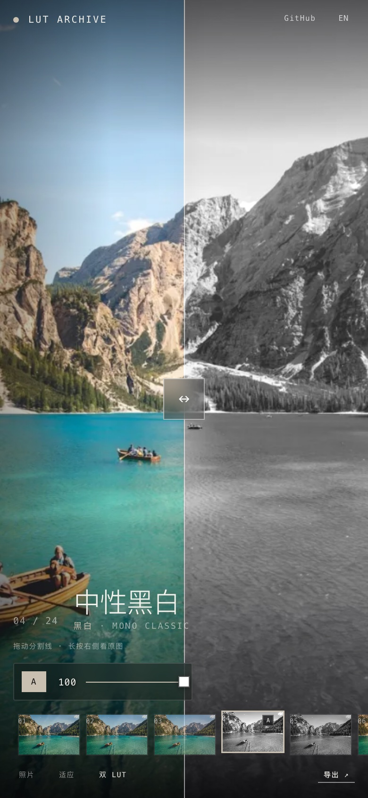

# LUT Archive

A darkroom-style photo LUT editor that runs entirely in your browser. Full-bleed
image, 24 hand-made looks, split-view compare, dual-LUT stacking and
full-resolution JPEG export — no accounts, no uploads, no server-side rendering.

**Live demo:** <https://lut.openanthropic.com>

| Desktop | Mobile |
| --- | --- |
|  |  |

Dual-LUT stacking:


## Features

- **24 original LUT looks** — cinema, film, B&W, Leica, Hasselblad and more,
  all designed for this project and bundled as a single 461 KB binary.
- **Split compare** — drag the vertical line; long-press the right side to see
  the original, release to restore. Fit/fill state is never touched.
- **Dual LUT stacking** — apply two looks at once with independent strength
  rails. Useful for a base grade plus a subtle skin-tone or highlight tweak.
- **Fit / fill**, drag-and-drop upload, EXIF orientation handled, full-resolution
  rendering.
- **Export** — JPEG at 50 / 75 / 100% of the source long edge (capped at 4096),
  quality 0.90 / 0.95 / 0.98.
- **Categories and named thumbnails** — filter the strip by 电影 / 胶片 / 黑白 /
  冷暖 / 风格 / 复古 / 空气感 / 徕卡 / 哈苏, every thumbnail carries its look name.
- **Import your own LUTs** — drop any `.cube` (LUT_3D_SIZE 2–64) into the app;
  it is parsed locally, stored in IndexedDB and appears under “我的 LUT / My LUTs”.
  Nothing is uploaded.
- **Bilingual UI** — Chinese / English, switchable and remembered. First visit
  picks the language from the visitor's country (CN/TW/HK/MO → Chinese).
- **Nothing leaves the device** — decoding, grading and encoding all happen in
  the browser. The only network calls are for static assets and a country code.

## How it works

The editor is plain ES modules and WebGL2 — no framework, no build step for the
app itself.

- `public/js/renderer.js` — `LookRenderer`: uploads the LUT binary as a 3D
  texture (17³ RGBA, trilinear filtering) and grades the photo in a fragment
  shader. Supports 1–3 stacked LUTs, `cover`/`contain` fit and UV flipping.
- `public/js/looks.js` — the manifest: id, display names, category, filmstrip
  ordering.
- `public/luts.bin` — 24 × 17³ RGBA blocks, in manifest order (461 KB).
- `luts-src/*.cube` — the 33³ source cubes. `npm run build:luts` resamples them
  into `public/luts.bin`; the output is byte-identical to the shipped binary.
- `src/worker.js` — a ~20 line Cloudflare Worker: serves the assets and
  `/api/geo`, which returns `request.cf.country` for language detection.

## Run locally

```bash
npm install
npm run dev        # wrangler dev → http://localhost:8787
```

Any static file server works too (`python3 -m http.server -d public`), except
that `/api/geo` will 404 and the UI falls back to `navigator.language`.

## Deploy

```bash
npm run deploy
```

`wrangler.jsonc` binds a custom domain (`lut.openanthropic.com`) via
`routes[].custom_domain` — wrangler creates the DNS record and certificate, so
the zone must live on the same Cloudflare account. Remove the `routes` block to
deploy to `*.workers.dev` instead.

## Regenerating the LUT bundle

```bash
npm run build:luts
```

### Why only 24 looks are bundled

The 24 shipped looks are generated by our own grade recipes and are MIT licensed.
Vendor LUTs (Panasonic VariCam/LUMIX, FUJIFILM F-Log, Canon, Nikon, Sony…) are
free to download but their terms only allow local personal use — they cannot be
redistributed in a public repository. That is exactly what the **Import LUT**
button is for: download the official `.cube` from the vendor, import it locally,
and it stays on your device.

Reads `luts-src/<id>.cube` in the order defined in `scripts/build-luts.mjs`,
resamples each 33³ cube to 17³ with trilinear interpolation, writes RGBA bytes
to `public/luts.bin`. Add a new look by dropping a `.cube` file into `luts-src/`,
adding it to `public/js/looks.js` and to the `ORDER` array in the build script.

## Project layout

```
public/            # the whole app (no build step)
  index.html       # UI + inline CSS + app logic
  js/renderer.js   # WebGL2 LUT renderer
  js/looks.js      # LUT manifest
  js/i18n.js       # zh/en strings
  js/lut-store.js  # IndexedDB store for imported .cube LUTs
  luts.bin         # baked LUT texture
  photos/          # sample photos
  fonts/           # IBM Plex Mono, Instrument Sans/Serif (woff2)
luts-src/          # 24 × 33³ .cube sources
scripts/           # build-luts.mjs
src/worker.js      # Cloudflare Worker (assets + /api/geo)
```

## Privacy

There is no backend state. No accounts, no database, no cookies. The language
preference is stored in `localStorage` (`lut.lang`); `/api/geo` returns a
two-letter country code derived from the Cloudflare edge and nothing is stored.
Imported LUTs are kept in IndexedDB on your device — they are never uploaded.

## Credits

- **Fonts** — IBM Plex Mono, Instrument Sans and Instrument Serif, distributed
  under the SIL Open Font License 1.1.
- **Sample photos** — Unsplash License.
- **LUT looks, renderer, UI** — original work, MIT.

## License

[MIT](LICENSE)
